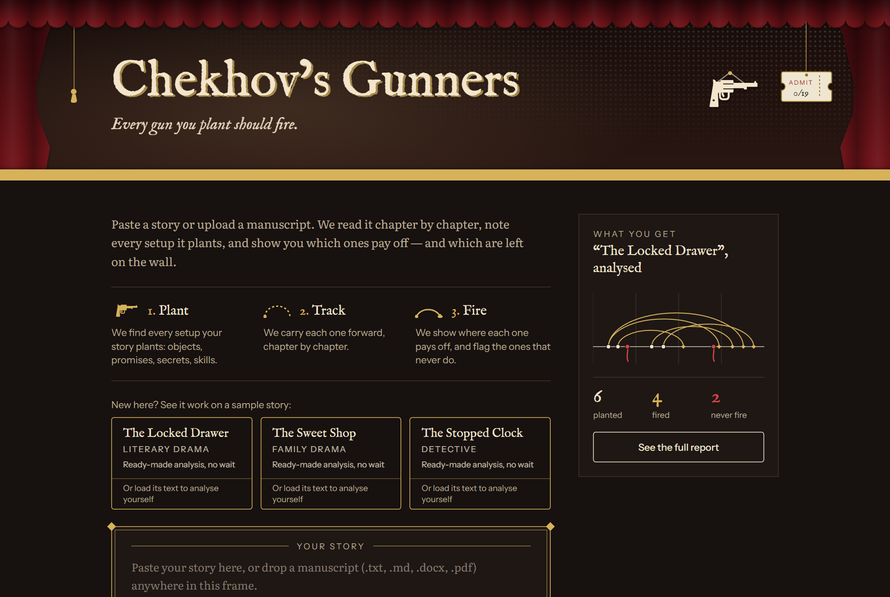
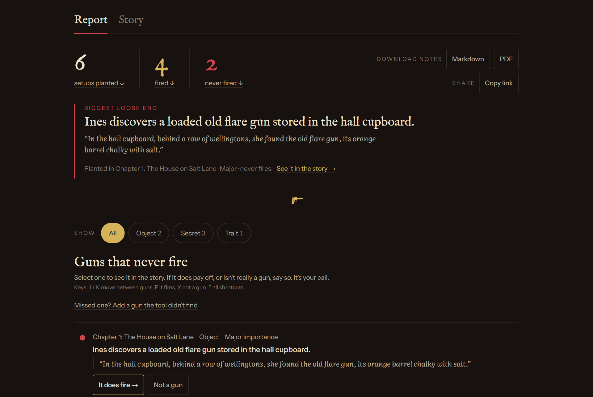
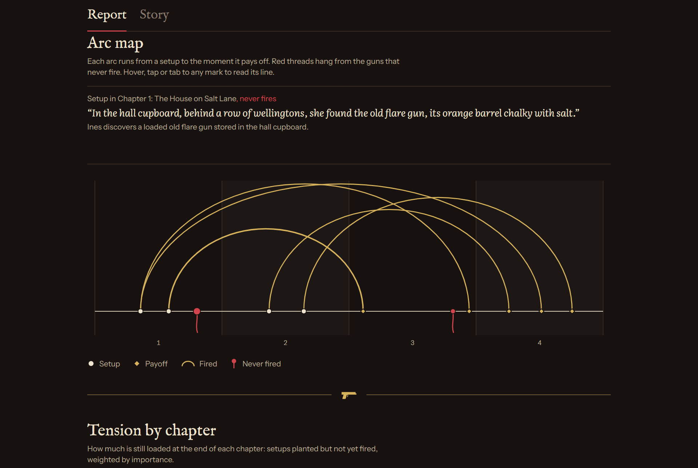
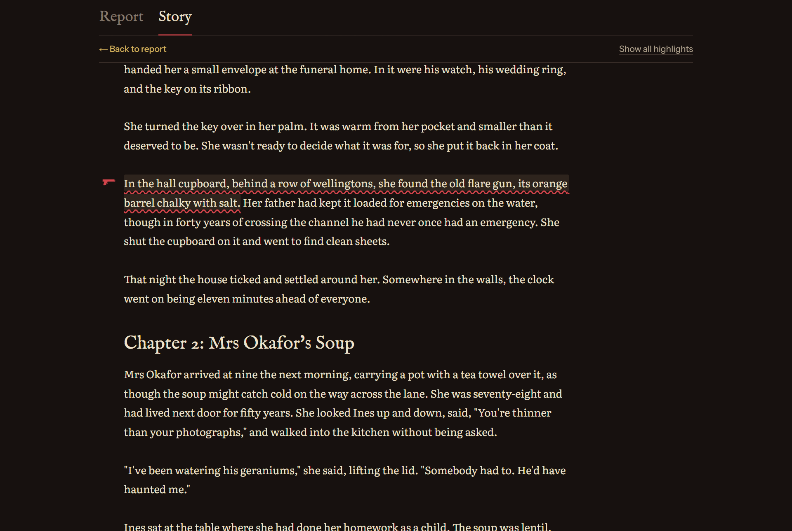
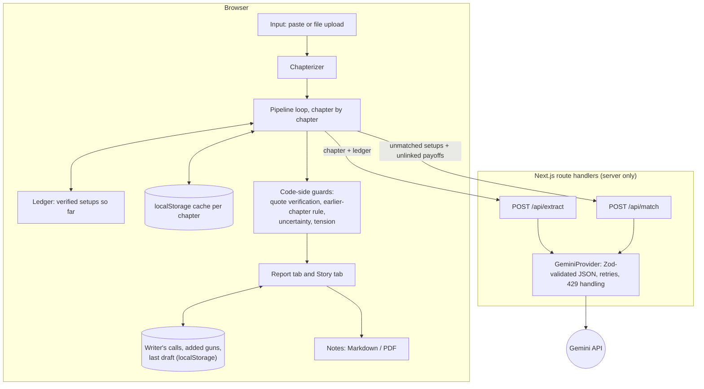

# Chekhov's Gunners

> Every gun you plant should fire.

**GeNarrative Clash 2026 · Storytelling & Co-Writers track · Team Chekhov's Gunners**

Chekhov's Gunners is a writing assistant for the oldest rule in dramatic craft. Paste or upload a short story (`.txt`, `.md`, `.docx`, text `.pdf`) and it finds every **setup** (a planted object, trait, secret, promise, skill or relationship), links each one to its **payoff**, and shows which setups never fire. Every finding is backed by an exact quote from your text. **It suggests; the writer decides.** The app never edits your story.

- **Live demo:** https://chekhovs-gunners.vercel.app
- **Demo video (2:19):** https://drive.google.com/file/d/1coVA025XYrATpTHkt9R3ll25J1Vp8hLB/view?usp=sharing



> **This is our 50% MVP.** The writer-facing app, the analysis pipeline and the first version of the prompts are built and live. The remaining 50%, the AI co-writing layer (genre-aware analysis with Adaption, "How could this fire?", a verifier pass, cheap-twist detection and fix suggestions), is built live at the finale. See [What is left for the live sprint](#what-is-left-for-the-live-sprint).

## The problem

*"If in the first act you have hung a pistol on the wall, then in the following one it should be fired. Otherwise don't put it there."* (Anton Chekhov)

Every story makes promises. A locked drawer, a skill mentioned in passing, a vow, a secret: each one tells the reader "this will matter". When a promise is never kept, readers feel cheated; when a payoff arrives with no setup, the twist feels unearned.

Keeping track of these threads is one of the hardest parts of revising a manuscript. A novel plants dozens of them across hundreds of pages and many drafts, and writers lose track of what they planted, what they cut and what still dangles. Today they rely on memory, spreadsheets, sticky notes or a patient editor. Grammar tools and general chatbots do not help: they read sentences, not the architecture of a story, and they cannot point to the exact line that made a promise.

**Who it is for:** novelists and short-story writers revising a draft, screenwriters checking an act, writing students learning structure, and editors giving structural notes.

## Our solution

Chekhov's Gunners reads the manuscript chapter by chapter and keeps a ledger of every promise the story makes. It shows which setups pay off, where, and which never fire, each one backed by the exact line from the text so the writer can check it in a second. The AI does the reading; code verifies every quote and every link; **the writer has the last word** and can overrule any verdict. Nothing in the manuscript is ever changed.

## Team

| Name | Role |
| --- | --- |
| Auritras Maitra | Team lead |
| Tanmoy Ghosh | Team member |
| Deepanjan Mandal | Team member |
| Anusree Mandal | Team member |

## Judge it in 60 seconds

1. Open the live demo and click any of the three samples (or **See the full report** in the "What you get" card). The saved report opens instantly and uses no AI quota.
2. Read **Guns that never fire**: each card quotes the line that planted the gun. Click one to jump to it in the Story tab, where it stands in a spotlight and the other highlights step back.
3. Open **Guns that fired** to check what the tool understood, then look at the **arc map** and the **tension** hill.
4. Disagree with it: on a card, press **It does fire →** and select the line where it pays off (a gold arc appears on the map), or **Not a gun** to set it aside. **Missed one? Add a gun** lets you select a line the tool missed.
5. **Download notes** as Markdown or PDF to take the loose ends to an editor.
6. To see a live run, click **Or load its text to analyse yourself** under any sample, then press **Analyse** (about a minute). Edit a line and analyse again to see **Since your last draft**.

## What you get

| Tab | Contents |
| --- | --- |
| Report | Summary counts (each links to its section) and the **biggest loose end**, **guns that never fire** with quotes, a collapsible list of **guns that fired** (one row per gun, every payoff listed), the animated **arc map** (setup to payoff; red threads for unfired guns), the per-chapter **tension** landscape and bars (select a chapter to filter the lists to it), and the **rhythm** of guns planted against guns fired, with a line on the balance (a rushed ending, a front-loaded story) |
| Story | The chapter text with setups and payoffs highlighted inline; jumping from a card spotlights that passage and fades the rest. Gun pins in the margin mark every setup; **J / K** walk the loose ends |



| Arc map | Story tab |
| --- | --- |
|  |  |

**The writer has the last word.** Every verdict can be overruled. Your calls are kept in your browser, per story, and never change the tool's own findings (both are shown).

- **It does fire →**: pick the chapter, then select the line where the gun pays off. It moves to "fired (marked by you)" and a gold arc grows on the map.
- **Not a gun**: set a finding aside (with Undo).
- **Missed one? Add a gun**: select the line that plants a gun the tool missed, and name it.
- **Filter by type** (object, secret, skill, promise...) across the lists and the arc map.
- **Download notes**: the loose ends with their quotes, your decisions and the guns that fired, as Markdown or a print-ready PDF playbill.
- **Share and reopen**: **Copy link** packs the whole report, with your calls, into a link (compressed into the part after `#`, which never reaches a server). Your last five reports are listed under the story box to reopen without any AI calls.
- **Keyboard**: **J / K** move between guns, **F** says it fires, **X** sets it aside, **?** lists every shortcut.
- **Compare drafts**: after you edit the story and analyse it again, **Since your last draft** lists the guns that now fire, the new loose ends, and loose ends whose line you cut. Each run words its findings afresh, so guns are paired across runs by the line they quote and by how alike their summaries read.

Three sample stories with writer-made answer keys: **The Locked Drawer**, **The Sweet Shop**, and **The Stopped Clock**, a detective case with two deliberate red herrings (useful for the genre work planned for the live sprint). A sample whose `public/samples/<slug>/result.json` exists opens instantly with no API call; otherwise its button loads the text for a live analysis.

The interface is a paper toy theatre: a cut-paper header whose layers drift with the pointer, curtains that close and part on the first report, an open book that turns a page for each chapter read and a live "Found" wall of guns, rotating public-domain lines on setup and payoff (Chekhov, Poe, Twain, Aristotle), an arc map that fires when it comes into view (a muzzle flash where each arc lands; a set-aside gun's thread falls off), a spotlight that glides onto the line you point to, a curtain call with a bow from the header gun when every gun fires, and a house-lights pull-cord that stretches and fades the stage between light and dark. Achievements arrive as admission tickets and collect in **the Programme**, a playbill that opens from the ticket hanging on the right of the stage. Every animation is off under `prefers-reduced-motion`; everything works by keyboard and at phone width. When the day's free AI quota runs out, the house is full: the app says so and offers a sample performance.

**Limits and timing.** One AI request per chapter plus one to link payoffs. Text without chapter headings is split into ~1,500-word parts. A 1,500-2,000-word story takes roughly 30-90 s. On the free tier, about 25,000 words (about 18 requests) can be analysed per day, so the app is built for short stories, novellas and screenplay acts. Re-running a story is instant: results are cached per chapter in the browser.

**Where your text goes.** Each chapter is sent to the AI model (Google Gemini) through our server only to be analysed; nothing is stored on our side, and the API key never reaches the browser. Your calls on the report, saved drafts and recent reports stay in your own browser. Share links carry the report after the `#`, which browsers never send to a server.

## How the AI is used

Gemini does the reading; code decides what counts.

| Step | Who does it | What happens |
| --- | --- | --- |
| Split into chapters | Code | Headings ("Chapter 3: ...", Markdown `#`), or ~1,500-word parts |
| Find setups and payoffs | **Gemini** (`/api/extract`, one call per chapter) | Returns each setup and payoff with an exact quote, its kind and importance, and links to earlier setups by ledger id |
| Link the leftovers | **Gemini** (`/api/match`, one call per story) | Sees only unmatched setups and unlinked payoffs, and explains each link |
| Check every quote | Code | Anything not found word for word in its chapter is dropped |
| Order, unfired guns, tension, uncertainty | Code | Payoffs must come after their setups; the rest is counted, not asked |
| Overrule, add, compare | The writer | The tool suggests; the writer decides |

Prompts and response schemas live in `lib/ai/`: prompts are versioned, and responses are Zod-validated JSON. The Gemini calls are the easy part. The reliability comes from the code around them:

1. **Ledger.** Chapters are analysed in order. Each `/api/extract` call gets the chapter text plus a compact **ledger** of the verified setups from earlier chapters (id, chapter, kind, short summary). The model can recognise a payoff to a setup it never saw the text of by citing the ledger id, and the cost per chapter stays flat as the story grows. A second `/api/match` call sees only the leftovers (unmatched setups, unlinked payoffs), not the full text.
2. **Quote verification (hallucination guard).** The model must return an exact quote for every setup and payoff. In code, after normalising whitespace and quote marks, anything whose quote is not found in its chapter is dropped and counted. Only verified setups enter the ledger, so one hallucination cannot poison later chapters.
3. **Code-side rules, not prompt hopes.** A payoff must come after its setup (later chapter, or later in the same chapter); links to unknown ids are dropped; unfired guns and per-chapter tension are computed in code.
4. **Failed-chapter uncertainty.** If a chapter fails (invalid JSON after 3 attempts), the run continues and the writer sees a banner with a **Retry chapter k** button. Results that a failed chapter could change are marked uncertain: an unfired setup is uncertain if a failed chapter comes after it, an unlinked payoff if a failed chapter comes before it. They are drawn dashed and counted separately instead of being presented as fact.

## Prompt design

Two prompts, each with one job, chained through code (`lib/ai/prompts.ts`):

| Prompt | Sees | Returns (Zod-validated JSON) |
| --- | --- | --- |
| **Extract** (`x2`), once per chapter | The chapter text, plus the **ledger** of setups verified in earlier chapters (`id \| chapter \| kind \| summary`) | `setups: [{ quote, kind, summary, importance 1-3 }]`, `payoffs: [{ quote, summary, firesSetupId }]` |
| **Match** (`m2`), once per story | Only the leftovers: setups no payoff has claimed, and payoffs not yet linked, each with its quote | `matches: [{ setupId, payoffId, reasoning }]` |

What makes the chain robust:

- **Grounded output.** Every item must carry an 8-40 word quote copied character for character from the chapter: *"No ellipses, no paraphrase, no fixing of typos or punctuation, no joining separate passages."* Code then checks each quote against the text and drops any that is not there, so the model cannot invent a line.
- **Closed vocabulary.** Setup kinds come from a fixed list (object, trait, secret, promise, skill, relationship, other); importance is a defined 1-3 scale; links may only use ids printed in the prompt: *"Use only ids from the ledger above, copied exactly. Never invent ids."*
- **Precision over recall.** *"Fewer, high-confidence items beat many weak ones... An empty list is a valid answer."* A tool writers trust must not cry wolf.
- **Order rules stated, then enforced.** The match prompt says a payoff must come after its setup; code enforces it again, so a prompt slip cannot produce a payoff before its setup.
- **Versioned and measured.** Each prompt has a version (`x2`, `m2`) that is part of the cache key, and `npm run prompt-check` scores every version against writer-made answer keys (see [Prompt-check metrics](#prompt-check-metrics)).

## Architecture



The Gemini key never reaches the browser. Prompts are versioned (`x2` extract, `m2` match); the version, model and ledger are part of every cache key, so a prompt change invalidates old results automatically.

## Tech stack

| Layer | Technology |
| --- | --- |
| Framework | Next.js 16 (App Router, Turbopack), React 19, TypeScript |
| Styling | Tailwind CSS 4, hand-drawn SVG, Web Animations API, view transitions |
| AI | Google Gemini (`gemini-3.5-flash`, with `gemini-3.5-flash-lite` as a fallback) via `@google/genai`; Zod for structured output |
| File input | `mammoth` (.docx), `pdfjs-dist` (.pdf, rebuilt into paragraphs) |
| Testing | Vitest (174 unit tests), ESLint |
| Hosting | Vercel (Hobby), serverless route handlers keep the API key on the server |
| Storage | None on the server; the browser's localStorage for caches, the writer's calls and recent reports |

## Local setup

```bash
npm install
cp .env.example .env.local   # then fill in the values below
npm run dev                  # http://localhost:3000
```

`.env.local`:

```
GEMINI_API_KEY_DEV=<key from your development Google Cloud project>
GEMINI_MODEL=gemini-3.5-flash        # default if unset
GEMINI_THINKING_LEVEL=medium         # default if unset; "low" is ~10x faster but misses subtle setups
GEMINI_FALLBACK_MODEL=gemini-3.5-flash-lite   # default if unset; empty disables
```

**Daily-quota fallback.** The free tier allows `gemini-3.5-flash` only 20 requests per day per project (a 4-chapter story uses about 5). When that runs out, the app switches to `gemini-3.5-flash-lite`, which has its own quota, and retries the main model an hour later. The same switch happens when the main model answers "high demand" (503) or stalls: the request moves to the lite model at once, and later chapters try the lite model first for two minutes. Every call has a 50-second limit and each request a 100-second budget, inside Vercel's 120-second cap, so a slow model never loses a chapter. On chapter 1 of the sample the lite model at `medium` thinking took ~6 s and also found all 3 planted setups. Results are cached under the main model's name whichever model answered. The metrics scripts never fall back, so their numbers always describe one model.

Measured on chapter 1 of the sample (Oct 2026, free tier): `gemini-3.5-flash` at `medium` thinking took ~27 s and found all 3 planted setups; at `low` ~3 s and found 2. Newer flash models were frequently returning 503 "high demand" on the free tier, which the app now waits out and retries.

**Two keys, two quotas.** `GEMINI_API_KEY_DEV` lives only in `.env.local` and is used by local `npm run dev` and by the scripts. `GEMINI_API_KEY` (a separate production project) is set only in Vercel and serves visitors, so developing never burns the judges' quota. `.env*.local` is git-ignored; `.env.example` is committed.

## Scripts

| Command | What it does |
| --- | --- |
| `npm run dev` / `build` / `start` | Next.js dev server, production build, serve the build |
| `npm test` | Vitest unit tests (chapterize, ledger, cache keys, quote verification, resolve, uncertainty, tension, routes, timeouts and model fallback, overrides, notes, compare drafts, PDF paragraphs, rhythm, share links). 174 tests, no AI calls |
| `npm run lint` | ESLint |
| `npm run build-samples` | Analyses each sample once and writes `public/samples/<slug>/result.json` (the static results the app loads instantly; until it has been run, no sample result exists) |
| `npm run prompt-check` | Runs every sample 5 times (`-- --runs N` to change, `--only slug,slug` for a subset) against its answer key and prints a Markdown metrics table |

`build-samples` and `prompt-check` use **only** `GEMINI_API_KEY_DEV` and exit if it is missing.

**Caching nuance.** The browser and `build-samples` cache per chapter, so unchanged chapters cost no quota on a re-run. `prompt-check` deliberately bypasses the cache (a fresh in-memory cache per run) so its 5 runs are independent measurements.

## Prompt-check metrics

Sample stories ship with writer-made answer keys (`samples/<slug>/answer-key.json`). Metrics are averaged over the runs stated under the table; the free tier's 20 requests a day limit how many fit in one day.

| Sample | Runs | Recall | Wrong setups | Wrong matches | Unfired correct | Quote drop rate |
| --- | --- | --- | --- | --- | --- | --- |
| the-locked-drawer | 2 | 100% | 2.0 | 0.5 | 1/1 | 0% |
| the-sweet-shop | 2 | 75% | 0.0 | 0.5 | 0/1 | 0% |
| the-stopped-clock | 1 | 67% | 1.0 | 1.0 | 1/2 | 0% |

**Before baseline:** `gemini-3.5-flash`, medium thinking · prompts extract `x2`, match `m2` (unchanged between runs) · one run per sample on 31 Oct and one on 6 Nov 2026, averaged (the free tier allows 20 requests a day). Produced with `npm run prompt-check -- --runs 1`. Single runs vary: The Sweet Shop's recall was 83% on the first run and 67% on the second.

What the baseline misses, and what the live sprint targets:

- **The Sweet Shop:** the brass bell (the story's deliberate unfired gun) is never found, so "unfired correct" is 0/1; the "hearing the syrup" skill is quoted from its payoff scene instead of where it is planted.
- **The Stopped Clock:** only one of its two deliberate unfired guns is flagged, with one wrong setup and one false link. A detective story's red herrings are meant to stay unfired, which is the case for genre-aware prompts.

These misses are why the app lets the writer overrule any verdict ("It does fire" / "Not a gun").

**Prompt freeze:** no prompt changes during evaluation, 17-19 Nov 2026.

## Repo layout

```
app/            Next.js pages and API routes (extract, match, meta)
components/     Input, run status, Report tab, Story tab; effects/ (theatre header, curtains,
                quotes, count-up) and landing/ (how it works, sample preview)
lib/ai/         ModelProvider + Gemini, prompts (versioned), Zod schemas
lib/analysis/   verifyQuotes, resolve, tension (pure code)
lib/pipeline/   The chapter-by-chapter analysis loop
lib/view/       Pure view logic: overrides, writer-added guns, notes, compare drafts, rhythm,
                share links, recent reports, biggest loose end,
                achievements, arc layout, summary counts
lib/            chapterize, ledger, cache, metrics, input readers
docs/           README screenshots
samples/        Answer keys; public/samples has the stories and results
scripts/        build-samples and prompt-check
tests/          Vitest suites
```

## 50/50 rule

The event rules allow teams to pre-build up to half of the project (*"wireframes, boilerplate code, trained prompts, or baseline UI"*) and require the rest (*"prompt tuning, API orchestration & inference hooks"*) to be built live in the 6-hour sprint on 21 Nov 2026. This repository is the pre-built half. The git tag `pre-event-50` marks the commit we submitted; everything after it is sprint work.

| Pre-built: baseline UI, boilerplate and trained prompts | Built live: prompt tuning, API orchestration and inference hooks |
| --- | --- |
| File input (`.txt`, `.md`, `.docx`, `.pdf`) and chapter splitting | **Genre-aware analysis with Adaption** (the headline, below) |
| The UI: report, story view, arc map, tension, rhythm, the theatre | **"How could this fire?"**: for each loose end, the AI suggests where it could pay off, quoting real later lines |
| Backend routes, rate limiting, the key kept server-side | **A verifier pass** that re-reads each link and scores its confidence |
| The first version of the prompts (extract, match) and the code-side quote checks | **Cheap-twist detection**: payoffs that come from nowhere |
| Free-tier resilience: waiting out 503s, lite-model fallback | **Fix suggestions** in the author's own style, with accept / reject |
| Writer tools that use no AI: overrides, added guns, filters, notes, compare drafts, share links, shortcuts | **Prompt tuning** against the answer keys, with before/after tables |

The prompts have only had bug fixes so far, so the prompt-check numbers above are the *before* baseline.

### What is left for the live sprint

**Genre-aware analysis, powered by Adaption.** Our baseline's clearest weakness is genre: in *The Stopped Clock*, a detective story, the deliberate red herrings are flagged as loose ends, when in a mystery they are meant to stay unfired. In the sprint we will:

1. **Build a genre benchmark with Adaption's Invent a Dataset**: short stories in four genres (detective, romance, fantasy, literary), each with an answer key (the line that plants each gun, its kind, where it fires or that it never does, and which guns are red herrings). Our own quote checker validates every generated answer key against its story.
2. **Detect the genre with Adaption's Responses API** (a small structured call), shown to the writer as genre choices above the story box, with "Detect for me" as the default.
3. **Tune the prompts per genre**, with worked examples drawn from the Adaption dataset, so that a mystery's red herrings are labelled "red herring (meant to stay unfired)" instead of being flagged.
4. **Measure it**: `prompt-check` scores every genre before and after, and the tables go in this README.

The full plan, with the other live features and a checklist, is in [LIVE_SPRINT.md](LIVE_SPRINT.md).

## Constraints

Free only: Gemini API free tier, Vercel Hobby, GitHub, and sponsor credits (Adaption) for the live sprint. No database. Built for short stories, novellas and screenplay acts (about 25,000 words a day on the free tier).

## License

See [LICENSE](LICENSE).
