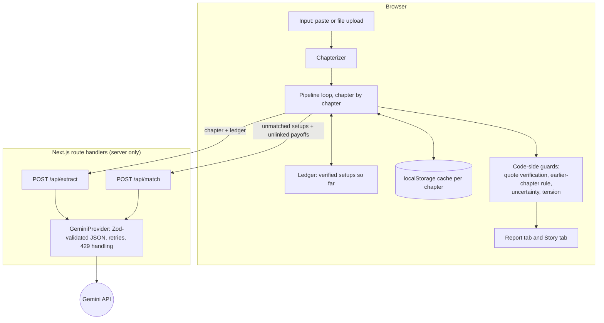

# Chekhov's Gunners

> Every gun you plant should fire.

**GeNarrative Clash 2026 · Storytelling & Co-Writers track · Team Chekhov's Gunners**

Chekhov's Gunners is a writing assistant for the oldest rule in dramatic craft. Paste or upload a short story (`.txt`, `.md`, `.docx`, text `.pdf`) and it finds every **setup** (a planted object, trait, secret, promise, skill or relationship), links each one to its **payoff**, and shows which setups never fire. Every finding is backed by an exact quote from your text. **It suggests; the writer decides.** The app never edits your story.

- **Live demo:** https://chekhovs-gunners.vercel.app
- Demo video: _coming soon_

## Judge it in 60 seconds

1. Open the live demo and click **The Locked Drawer** (or **See the full report** in the "What you get" card). The saved report opens instantly and uses no AI quota.
2. Read **Guns that never fire**: each card quotes the line that planted the gun. Click one to jump to it in the Story tab, where it stands in a spotlight and the other highlights step back.
3. Open **Guns that fired** to check what the tool understood, then look at the **arc map** and the **tension** hill.
4. To see a live run, click **The Sweet Shop (Kolkata)** to load its text and press **Analyse** (about a minute).

## What you get

| Tab | Contents |
| --- | --- |
| Report | Summary counts (each links to its section), **guns that never fire** with quotes, a collapsible list of **guns that fired** (one row per gun, every payoff listed), the animated **arc map** (setup to payoff; red threads for unfired guns), and the per-chapter **tension** landscape and bars |
| Story | The chapter text with setups and payoffs highlighted inline; jumping from a card spotlights that passage and fades the rest |

Three sample stories with writer-made answer keys: **The Locked Drawer**, **The Sweet Shop (Kolkata)**, and **The Stopped Clock**, a detective case with two deliberate red herrings (useful for the genre work planned for the live sprint). A sample whose `public/samples/<slug>/result.json` exists opens instantly with no API call; otherwise its button loads the text for a live analysis.

The interface is a paper toy theatre: a cut-paper header whose layers drift with the pointer, curtains that part on the first report, rotating public-domain lines on setup and payoff (Chekhov, Poe, Twain, Aristotle) while a story is read, and a running clock so long chapters visibly progress. Every animation is off under `prefers-reduced-motion`.

**Limits and timing.** One AI request per chapter plus one to link payoffs. Text without chapter headings is split into ~1,500-word parts. A 1,500-2,000-word story takes roughly 30-90 s; ~25,000 words (about 18 requests) is the practical maximum for one day on the free tier. Re-running a story is instant: results are cached per chapter in the browser.

## How it works

The Gemini calls are the easy part. The reliability comes from the code around them.

1. **Ledger.** Chapters are analysed in order. Each `/api/extract` call gets the chapter text plus a compact **ledger** of the verified setups from earlier chapters (id, chapter, kind, short summary). The model can recognise a payoff to a setup it never saw the text of by citing the ledger id, and the cost per chapter stays flat as the story grows. A second `/api/match` call sees only the leftovers (unmatched setups, unlinked payoffs), not the full text.
2. **Quote verification (hallucination guard).** The model must return an exact quote for every setup and payoff. In code, after normalising whitespace and quote marks, anything whose quote is not found in its chapter is dropped and counted. Only verified setups enter the ledger, so one hallucination cannot poison later chapters.
3. **Code-side rules, not prompt hopes.** A payoff must come after its setup (later chapter, or later in the same chapter); links to unknown ids are dropped; unfired guns and per-chapter tension are computed in code.
4. **Failed-chapter uncertainty.** If a chapter fails (invalid JSON after 3 attempts), the run continues and the writer sees a banner with a **Retry chapter k** button. Results that a failed chapter could change are marked uncertain: an unfired setup is uncertain if a failed chapter comes after it, an unlinked payoff if a failed chapter comes before it. They are drawn dashed and counted separately instead of being presented as fact.

## Architecture



The Gemini key never reaches the browser. Prompts are versioned (`x2` extract, `m2` match); the version, model and ledger are part of every cache key, so a prompt change invalidates old results automatically.

## Local setup

```bash
npm install
cp .env.example .env.local   # then fill in the values below
npm run dev                  # http://localhost:3000
```

`.env.local`:

```
GEMINI_API_KEY_DEV=<key from your development Google Cloud project>
GEMINI_MODEL=gemini-3.5-flash        # default if unset
GEMINI_THINKING_LEVEL=medium         # default if unset; "low" is ~10x faster but misses subtle setups
GEMINI_FALLBACK_MODEL=gemini-3.5-flash-lite   # default if unset; empty disables
```

**Daily-quota fallback.** The free tier allows `gemini-3.5-flash` only 20 requests per day per project (a 4-chapter story uses about 5). When that runs out, the app switches to `gemini-3.5-flash-lite`, which has its own quota, and retries the main model an hour later. On chapter 1 of the sample the lite model at `medium` thinking took ~6 s and also found all 3 planted setups. Results are cached under the main model's name whichever model answered. The metrics scripts never fall back, so their numbers always describe one model.

Measured on chapter 1 of the sample (Oct 2026, free tier): `gemini-3.5-flash` at `medium` thinking took ~27 s and found all 3 planted setups; at `low` ~3 s and found 2. Newer flash models were frequently returning 503 "high demand" on the free tier, which the app now waits out and retries.

**Two keys, two quotas.** `GEMINI_API_KEY_DEV` lives only in `.env.local` and is used by local `npm run dev` and by the scripts. `GEMINI_API_KEY` (a separate production project) is set only in Vercel and serves visitors, so developing never burns the judges' quota. `.env*.local` is git-ignored; `.env.example` is committed.

## Scripts

| Command | What it does |
| --- | --- |
| `npm run dev` / `build` / `start` | Next.js dev server, production build, serve the build |
| `npm test` | Vitest unit tests (chapterize, ledger, cache keys, quote verification, resolve, uncertainty, tension, routes). No AI calls |
| `npm run lint` | ESLint |
| `npm run build-samples` | Analyses each sample once and writes `public/samples/<slug>/result.json` (the static results the app loads instantly; until it has been run, no sample result exists) |
| `npm run prompt-check` | Runs every sample 5 times (`-- --runs N` to change, `--only slug,slug` for a subset) against its answer key and prints a Markdown metrics table |

`build-samples` and `prompt-check` use **only** `GEMINI_API_KEY_DEV` and exit if it is missing.

**Caching nuance.** The browser and `build-samples` cache per chapter, so unchanged chapters cost no quota on a re-run. `prompt-check` deliberately bypasses the cache (a fresh in-memory cache per run) so its 5 runs are independent measurements.

## Prompt-check metrics

Sample stories ship with writer-made answer keys (`samples/<slug>/answer-key.json`). Metrics are averaged over the runs stated under the table; the free tier's 20 requests a day limit how many fit in one day.

| Sample | Recall | Wrong setups | Wrong matches | Unfired correct | Quote drop rate |
| --- | --- | --- | --- | --- | --- |
| the-locked-drawer | not yet measured | not yet measured | not yet measured | not yet measured | not yet measured |
| the-sweet-shop | not yet measured | not yet measured | not yet measured | not yet measured | not yet measured |
| the-stopped-clock | not yet measured | not yet measured | not yet measured | not yet measured | not yet measured |

Produce it with `npm run prompt-check` (needs `GEMINI_API_KEY_DEV`). The latest numbers will be recorded here with the date, model and prompt versions (currently extract `x2`, match `m2`).

**Prompt freeze:** no prompt changes during evaluation, 17-19 Nov 2026.

## Repo layout

```
app/            Next.js pages and API routes (extract, match, meta)
components/     Input, run status, Report tab, Story tab; effects/ (theatre header, curtains,
                quotes, count-up) and landing/ (how it works, sample preview)
lib/ai/         ModelProvider + Gemini, prompts (versioned), Zod schemas
lib/analysis/   verifyQuotes, resolve, tension (pure code)
lib/pipeline/   The chapter-by-chapter analysis loop
lib/            chapterize, ledger, cache, metrics, input readers
samples/        Answer keys; public/samples has the stories and results
scripts/        build-samples and prompt-check
tests/          Vitest suites
```

## 50/50 rule

This repo is the pre-built half. The features to be built live in the 6-hour sprint on 21 Nov 2026 are listed in [LIVE_SPRINT.md](LIVE_SPRINT.md).

**Pre-built (as the organizers confirmed is allowed):** file input, UI, backend routes, and the basic Gemini pipeline that extracts and matches setups/payoffs, with code-side quote checks. Also pre-built, as error handling so the online demo keeps working on the free tier: waiting out 503 "high demand" errors and falling back to a lite model when the daily quota runs out.

**Not pre-built:** the prompts have only had bug fixes so far. The prompt-check numbers above are the *before* baseline; deep prompt tuning happens live, with before/after tables.

## Constraints

Free only: Gemini API free tier, Vercel Hobby, GitHub. No database. Built for short stories and screenplay acts up to roughly 20,000 words.

## License

See [LICENSE](LICENSE).
